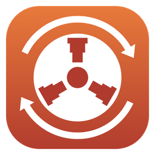
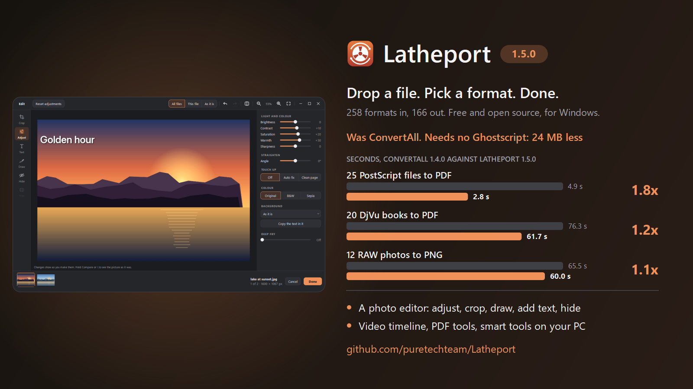

<p align="center"></p>

# Latheport

Convert, compress, edit or extract any file. Drop it in, pick a format, done. By Pure Tech, for Windows.

<p align="center">
  
</p>

What's new: see the [changelog](CHANGELOG.md).

**Latheport was called ConvertAll until 1.5.** Nothing to set up again: the first time it opens, your settings, presets, watch folders, downloaded engines and smart tools, the right-click menu and the Start menu shortcut come along by themselves.

## Just want the app?

Download **`Latheport-<version>-windows.zip`** (78 MB) from the [latest release](https://github.com/puretechteam/Latheport/releases/latest), unzip it, and run **`Latheport\Latheport.exe`**. Nothing to install.

Move the `Latheport` folder wherever you like. Keep `Latheport.exe` and its `_internal` folder together: the exe won't start without it.

## Using it

- **Window:** `Latheport.exe`. It has no system title bar: drag it by its header (with the version beside the name), double-click there to maximise; it still snaps to the screen's edges and shows Windows 11's snap layouts. Drop files or folders on it, choose a format (the most common conversion for that file is already picked, and next time it remembers yours), click **Convert**. Archives also get **Extract here**. While it runs, **Convert** turns into **Cancel**; closing the window mid-conversion asks first, then stops it cleanly. Output lands next to the original and never overwrites (`photo (1).png`). From the keyboard: Ctrl+O chooses files (or Tab to the drop area and press Enter), Ctrl+Enter converts, Esc cancels.
- **Keyboard:** Ctrl+O chooses files (or Tab to the drop area and press Enter), Ctrl+Enter converts, Esc cancels.
- **3D preview:** drop one 3D model or CAD part and it shows right in the window: drag to turn it, right-drag to move it, scroll to zoom. The expand button in its corner (or a double-click) opens it in a big window with a wireframe view and its size, parts, triangles and materials. Animated models play, in the preview and in the big window, where you can pause, scrub along the timeline, or pick which take to play; rigged characters bend and blend shapes change as they move. It shows every format below that Latheport can turn into a 3D model, textures and colors included.
- **What it keeps:** point at a format in the list to see the route it takes (*via PDF*) and what it can't keep, for example *"JPG has no transparency: see-through areas become white"* or *"STL holds one mesh: all parts are merged into one"*. After converting, the status line says the most important of those, and **Details** shows the whole report: the route and the tools that did each step, what was left out, and what Latheport checked on the result (see [What Latheport checks](#what-latheport-checks)). *Copy report* puts it on the clipboard.
- **Options and presets:** under the format there's an **Options** bar. Open it and a panel beside the window shows what the chosen format takes, and only that, under headings (*Picture*, *Video*, *Sound*, *Cut and size*, *Speed*, *Smart tools*); the window gets wider, never taller, and what doesn't fit scrolls in the panel: quality (a slider) and maximum size for photos, colour depth (8 or 16 bits) for PNGs and TIFFs of RAW, EXR, HDR and XCF pictures, resolution for PDF pages, video quality, size and frame rate, sound bitrate, where sound and video start and end (*Start at*, *End at*), a size to fit in (*Fit in*: 10 MB for Discord, 25 MB for email), even loudness (-14 LUFS for streaming, -23 for TV), *Speed* for sound and video (0.25x to 4x; voices keep their pitch unless you set *Pitch* to change with it) and *Backwards*, mesh detail for CAD parts, page size and text size for ebooks made into PDFs, and the [smart tools](#smart-tools)' settings (*Upscale*, *Make searchable*, *Subtitles from*, *Subtitles of what's said*, *Language*). Sizes, resolutions, frame rates and bitrates offer the usual values and take any other you type. Presets are one click (*Default*, *Smaller for email and web*, *Best quality*, *For phones and social*, *Ready for 3D printing*); set your own and *+ Save as preset* keeps them. Nothing set means Latheport's usual defaults; your choices are remembered (except *Start at*, *End at*, *Speed*, *Backwards* and the smart tools' but *Language*, which are for the files at hand), and the Options bar says what's on. Pictures and videos also get **Edit…** at the top of the panel, with what's been done beside it.
- **The editor:** for pictures and videos, **Edit…** in Options (or the pencil on the dropped file) opens a dark photo-editor window: the tools down the left (*Crop*, *Adjust*, *Text*, *Draw*, *Hide*, and *Trim* for videos), the tool's options along the top, the files in a strip along the bottom.
  - *Crop* (C): drag the box or its corners, or lock it to *Original*, *1:1*, *4:5*, *16:9* or *9:16*; turn a quarter left or right and mirror, the box turning with the picture. As in photo apps, a grid of thirds shows while the box moves, a line shows when it's in the middle, its edges snap to the picture's, and a label gives its size in pixels and names the shape when it is one (*1080 × 1350 · 4:5*).
  - *Adjust* (A): *Background* (*Taken out*, *White*, *Black* or *Blurred*, a [smart tool](#smart-tools), shown on the picture once it's found) and *Copy the text in it*, which reads a picture's text onto the clipboard; sliders for *Brightness*, *Contrast*, *Saturation*, *Warmth* and *Sharpness*; *Straighten* a crooked horizon up to 15 degrees either way (a grid shows while you drag, and the edges are cut in so no corner is empty); *Touch up* (auto fix a dull or tinted photo, or clean up a photo of a page into white paper and dark writing), black and white or sepia, and *Deep fry* for the meme look (1 to 100%). All shown on the picture as you set them.
  - *Text* (T) works as in Photoshop: click anywhere on the picture and type there (Ctrl+V pastes). The bar sets the font (Sans, Serif, Bold, Handwriting), size, colour and an outline or a shadow, for the next text or for the one you've clicked. Click a text to type in it or drag it; Enter or Esc when done; Delete removes it. *Meme* adds big outlined captions at the top and bottom (type to replace the top one). The panel on the right holds your *Watermark*: your own text, a picture (your logo, best as a PNG with a see-through background) or both, small in a corner of every file and as see-through as its *Opacity* says. It's kept for next time and never there unless you add one.
  - *Draw* (D): arrows, lines, boxes and ellipses (hold Shift for lines at 45 degrees and square boxes), the pen, the highlighter, and stickers: a tick, a cross, a star, a heart, and numbers that count 1, 2, 3 in the order you put them down, for how-tos. Pick the colour, the width and whether shapes are filled in the panel. *Select* picks a drawing up to move it; Delete removes it. Drawings stay on what they point at when you change the crop.
  - *Hide* (H): drag a box over a face, a number plate or a password, and choose *Pixelate*, *Blur* or *Cover* (solid black: the safe way to hide text, which blurring doesn't always hide) and how strongly. Drag a box to move it, its corners to size it. Nothing outside the box changes.
  - **Videos play in the editor**, with their sound: Space plays and pauses, comma and period step one frame back or on, and the timeline under the picture shows the whole video in pictures. Click or drag on it to go anywhere. While it plays you see it turned, cropped, drawn on and in black and white; pause and the picture is made by FFmpeg with every effect, exactly as the converted video will look.
  - *Trim* (V): drag either end of the timeline to keep just a part (the picture follows the handle), or press I and O to start or end it where you are. *Speed* (0.25x to 4x, with *Pitch* kept or changing), *Backwards*, and *Save this frame*, which puts a picture of the frame next to the video with every edit on it (`talk at 0-12.4.png`, never over another file). Trims and speed are each video's own, even when the other edits go to all files.
  - Edits go to **all files** unless one has its own: the switch on the top right says *All files*, *This file* or *As it is* for the file shown, and the strip marks the files with their own (a dot) or left as they are (a slash). A crop locked to a shape fits each file's own size.
  - For PDFs, **Edit…** opens the **Pages** window: every page as a picture. Drag pages into another order, turn them (Ctrl+[ and Ctrl+]), take them out (Delete), with Undo; *Save the picked pages as a PDF* puts the pages you picked, in that order, in a PDF of their own next to the file. With *Join* ticked, all the PDFs show as one grid, so you merge and order them at once. Bookmarks follow their pages and the document's title stays. A PDF that only has permissions set (it opens without a password but may not be edited) can be edited, joined, split and compressed too, and the result is locked the same way; one that needs a password to open is refused, never unlocked.
  - Undo and Redo (Ctrl+Z, Ctrl+Y), hold *Compare* (or `\`) to see the file as it was, scroll to zoom where the pointer is, Space-drag to look around, Ctrl+0 to fit.
- **Terminal:** `latheport-cli.exe` (or `latheport` when installed with pip). Ctrl+C stops a conversion cleanly, as *Cancel* does.
- **Right-click:** in the window, go to ☰ → *Add to right-click menu*. Explorer then shows **Open with Latheport** on files and folders (they open in the window, ready to convert), **Extract with Latheport** on archives (zip, rar, 7z, iso, tar.gz and the rest), which unpacks straight away (select several archives and they're extracted as one batch), and **View with Latheport** on 3D models and CAD parts, which opens just the viewer. On Windows 11 it's under *Show more options*. If Windows asks *Do you want to open this file?* when you extract a downloaded archive, that's Windows' check on files from the internet, not Latheport: it asks when another program (DAEMON Tools, for one) has registered itself for that kind of archive without marking it safe to open, and its *Type* line names that program. Click *Open* and Latheport extracts it; to skip the question for one file, tick *Unblock* in its Properties first. After an update, or if you move Latheport to another folder, the menu points to it again the next time you open it.
- **Start menu:** ☰ → *Add to Start menu*, then type "Latheport" in Start to open it. If you move Latheport to another folder, the shortcut follows it the next time you open it there.
- **More files while it's busy:** drop them anyway. They wait their turn in a list under the window (each becomes what's converting now when it can, else what that kind of file usually becomes); select one and press Delete to take it out. *Cancel* stops the list too.
- **Watch folders:** ☰ → *Watch folders…*, add a folder and pick what its files become. While Latheport is open, anything that lands there (a download, a scan, a copy) is converted into a `Converted` folder inside it once it has finished arriving; the original stays, and files that were there before are left alone. Tick *Keep watching from the notification area* to keep it going after closing the window; a file that fails then says so in a notification. A folder that isn't there (renamed, or on a drive that isn't plugged in) shows as *not there* in the list and is watched again once it's back. From a terminal: `latheport watch Downloads --to pdf`.
- **Updates:** once a day (also while the window stays open for days, and an hour later when GitHub couldn't be reached), the window asks GitHub whether a newer Latheport is out and, if so, says so in a slim banner under the header. **Update now** (with its size) downloads it, with progress and *Cancel*, checks it against the SHA-256 GitHub lists for it, and unpacks it next to your copy; **Restart to update** closes Latheport and opens the new version in the same folder, so the right-click menu and Start menu shortcut keep working. Your old copy is kept until the new one has opened, and comes back by itself if it doesn't. It always goes straight to the newest version, however many you've skipped. *See what's new* opens the release's page, *Not now* hides that version for good, *Later* keeps a downloaded update for the next restart. Nothing is downloaded or installed without the click, and nothing about you or your files is sent. Turn it off in ☰ → *Check for updates once a day*. (From source, or in a folder Latheport can't write to, the banner links to the release instead.) **Update now** came in 1.5: ConvertAll 1.4 and earlier only linked to the release, so getting 1.5 is the one download you unzip yourself.

## Smart tools

Four tools run a model on your computer: nothing is sent anywhere. None of them is in the download: each is
downloaded once, the first time it's needed, after asking (with its size), checked against its pinned SHA-256
and kept in Latheport's own folder. ONNX Runtime, which runs them, comes with the first (15 MB). They use at most
three quarters of the cores.

| Tool | What it does | Download |
|---|---|---|
| Background remover | a picture's background taken out (see-through), made white or black, or blurred like portrait mode: *Background* in the editor's *Adjust* panel (for every file at once with *All files*), `--background remove` | 190 MB ([BiRefNet](https://github.com/ZhengPeng7/BiRefNet), MIT) |
| Upscaler | pictures made 2 or 4 times bigger with sharp edges drawn in: *Upscale*, `--upscale 2` | 5 MB ([Real-ESRGAN](https://github.com/xinntao/Real-ESRGAN), BSD-3) |
| Text reader (OCR) | a picture's text into a text file (any picture → txt), *Copy the text in it* in the editor, and scanned PDFs made searchable: *Make searchable*, `--searchable yes`. Latin letters: English, French, German, Spanish and 28 more | 10 MB ([PaddleOCR](https://github.com/PaddlePaddle/PaddleOCR), Apache-2.0) |
| Speech recognition | what's said in sound or video written down: subtitles (sound or video → srt, vtt, ass...), a transcript (→ txt), or added to a video burned in or as a track: `--subtitles-from speech`, `--speech-subs burn`. 99 languages, heard or set with `--language` | 80 MB ([Whisper](https://github.com/openai/whisper) base, MIT) |

They're listed in ☰ → *Engines…* (and `latheport engines`), where each can also be installed ahead of time.

## Help and chat

Questions, a file that won't convert, an idea, or just want to talk about it? Join us on **[Discord](https://discord.gg/dRMRGCG9Fk)**. It's also in the window, under ☰ → *Help and chat on Discord*.

## What it handles

| Kind | Formats | Engine |
|---|---|---|
| Images | png jpg webp gif bmp tiff ico heic avif jp2 tga qoi dds icns pcx ppm sgi xbm psd cur xpm, all to each other; any picture → **svg** (traced into vector shapes); svg/svgz and pdf-compatible ai → images/pdf; pdf → svg; any picture → **txt** (its text, read by OCR) | built in ([vtracer](https://github.com/visioncortex/vtracer) for tracing; OCR is a [smart tool](#smart-tools)) |
| PostScript | eps ps → pdf (and on to images, svg, dxf); pdf → eps/ps; images → eps | built in ([bookport](https://github.com/puretechteam/bookport)) |
| Windows metafiles | emf wmf → png/svg/pdf | LibreOffice |
| Camera RAW, GIMP, HDR, JPEG XL | dng cr2 cr3 nef arw orf rw2 raf xcf exr hdr jxl → png jpg tiff (RAW at the camera's full size, 16 bits a channel in PNG and TIFF, or 8 if you choose); png jpg tiff → jxl exr hdr (a JPG becomes a JPEG XL about 17% smaller without changing a pixel, and can be turned back into the very same JPG) | built in ([pixport](https://github.com/puretechteam/pixport)) |
| Audio | mp3 wav flac ogg opus m4a m4b m4r (iPhone ringtone, first 40 s) aac wma aiff ac3 amr mka wv caf mp2 au, plus ape dsf dff (DSD) in; cut, fit in a size, even out loudness (also to the same format), join several into one | FFmpeg |
| Video | mp4 mkv webm mov avi wmv flv f4v asf vob m4v mpg ts 3gp ogv, plus mxf rm rmvb 3g2 in; video → gif, animated webp or audio; cut, fit in a size (two-pass), even out loudness (also MP4 to MP4), join several into one | FFmpeg |
| Subtitles | srt vtt ass ssa sbv (YouTube) sub (MicroDVD) ttml/dfxp smi (SAMI), all to each other; pull the subtitle track out of a video; sound and video → subtitles or txt of what's said | built in ([pysubs2](https://github.com/tkarabela/pysubs2); FFmpeg for videos; speech recognition is a [smart tool](#smart-tools)) |
| Office | docx doc odt rtf pages wps wpd hwp (+ docm dotx dot), xlsx xls ods numbers csv dbf (+ xlsm xlsb xltx), pptx ppt odp key (+ pptm ppsx pps potx) → pdf and each other; pdf → docx; html → rtf | LibreOffice |
| Drawings | vsdx vsd (Visio), pub (Publisher), odg, cdr (CorelDRAW) → pdf/png/svg | LibreOffice |
| PDF | pdf → images (one folder per multi-page doc), pdf → txt, images/txt/html/md → pdf, xps oxps → pdf; pdf → pdf to choose, order, turn, join, split, compress or make scans searchable | built in ([PDFium](https://pdfium.googlesource.com/pdfium/) through pypdfium2; Qt draws XPS and SVG; bookport lays out html and txt) |
| Markdown & HTML | md ↔ html, md/html → docx/odt, docx → html/md; mht/mhtml saved pages → html/pdf; Jupyter ipynb → md/html (and on to pdf/docx) | built in |
| Markup languages | tex (LaTeX), rst, org, adoc (AsciiDoc), wiki (MediaWiki), typ (Typst), dbk (DocBook), man pages, textile ↔ md html docx odt epub, and each other; equations (TeX, Typst, MathML, Word's) and BibTeX citations come along. Markup that refers to pictures comes out as a folder with them | built in ([bookport](https://github.com/puretechteam/bookport)) |
| Scanned books | djvu → pdf (searchable, with its outline as bookmarks; and on to images), djvu → txt (its OCR layer) | built in ([bookport](https://github.com/puretechteam/bookport)) |
| Comics | cbz cbr cb7 cbt → pdf (pages kept as they are, in reading order), between each other, and pdf → cbz/cb7/cbt; a folder of images → pdf or cbz. Renamed comics (a "cbr" that's really a zip) are detected by content | built in ([packport](https://github.com/puretechteam/packport) for RAR comics) |
| Ebooks | epub mobi azw3 azw fb2 fbz lit pdb lrf htmlz txtz pml pmlz rb tcr snb, all to each other, and chm in; ebooks → pdf (page size and text size as settings), docx, rtf, html, md, txt; html/docx/odt/rtf/md/txt and pdf → ebooks; comics → fixed-layout epub/mobi/azw3 and the rest. Copy-protected (DRM) books are refused, never unlocked | built in ([bookport](https://github.com/puretechteam/bookport)) |
| Email | eml and Outlook msg → pdf/html/txt: headers, the message (with its inline pictures) and a list of attachments | built in |
| Maps & GPS | gpx kml kmz geojson, all to each other; → csv (one row per point) | built in |
| Contacts & calendars | vcf (vCard) ↔ csv/json, ics (iCalendar) ↔ csv/json; Google and Outlook CSV exports are understood | built in |
| 3D models | stl obj ply off glb gltf 3mf dae fbx 3ds usd usdz abc, all to each other, and Blender's blend → all of them (parts, colors and textures kept where the format can hold them). FBX: binary and ASCII, 2006 onward; textures are found even when the file points at another PC. USD: usda, usdc and usdz, with references, payloads and variants. Alembic: the Ogawa kind (2013 onward). blend: Blender 2.8 onward (checked with 2.83, 2.93, 3.3, 3.5 and later), with modifiers, curves, text and metaballs as Blender shows them. Animation is kept between FBX, glTF, USD and Alembic, and read from 3DS and blend; skeletons (skinning) and blend shapes between FBX, glTF and USD, and from blend | built in ([meshport](https://github.com/puretechteam/meshport) for FBX, 3DS, USD, Alembic and blend) |
| CAD | step/stp, iges/igs, brep → watertight stl (and from there any mesh format); dxf → svg/pdf/png; svg/pdf vector drawings → dxf (for laser cutters) | [gmsh](https://gmsh.info) for step, iges and brep (downloaded the first time a part needs it); the rest built in |
| Medical | DICOM (.dcm or no extension) → png/jpg/tiff/… with the scanner's display window applied; multi-frame → folder, gif or multi-page tiff/pdf; header → json | built in |
| Data | json jsonl yaml toml xml ini plist csv tsv xlsx sqlite, all to each other | built in |
| Fonts | ttf otf woff woff2, all to each other (TrueType and CFF outlines converted as needed); ttc collections → their fonts | built in |
| Archives | create zip 7z rar tar tar.gz tar.bz2 tar.xz tar.zst tar.lz4 gz bz2 xz zst lz4 br lzma z cpio iso wim from **any file or folder**; extract all of those plus cab arj lzh dmg rpm deb ar msi msp xar/pkg vhd vhdx vmdk vdi qcow2 img squashfs udf apfs hfs zipx chm lit, split archives (.001, .r00), and zip-based packages (jar war ear apk aab ipa xpi crx vsix nupkg whl appx msix); disk images give the files on them (FAT, NTFS, ext2/3/4, HFS+, APFS), a folder per partition; repack any archive into another | built in ([packport](https://github.com/puretechteam/packport) for rar, cab, iso, udf, wim, disk images and the rest; no 7-Zip needed) |

When there's no direct conversion, Latheport chains steps automatically, for example docx → pdf → png, fbx → glb → 3mf, or step → stl → glb. If a step needs an engine that's missing, Latheport offers a one-time install right from the window (with `winget`; gmsh, which winget doesn't carry, is downloaded from its official release on PyPI, checked against its published SHA-256 and unpacked into Latheport's own folder). The [smart tools](#smart-tools) are offered the same way. Check engine status with ☰ → *Engines…* or `latheport engines`.

STL and 3MF are written Z-up (and read as Z-up), so models stand upright in 3D-printing slicers. The other 3D formats are Y-up.

Photos keep their details (camera, date, place: EXIF) and color profile when the new format can hold them (jpg png webp tiff heic avif); the picture is turned upright first, so it no longer needs its rotation flag. A file named for the wrong format (a JPEG saved as `.png`, which happens a lot with downloads) is converted as what it really is, and the report says so.

Some outputs come back as a **folder**: multi-page PDFs and multi-frame DICOMs saved as single-image formats, plus OBJ and USD models that have textures or materials (stored as side files).

<p align="center">
  <picture>
    <source media="(prefers-color-scheme: dark)" srcset="screenshots/extracting_dark.png">
    
  </picture>
</p>

Extracting is careful with archives from the internet: nothing lands outside the folder, links are left out, names Windows can't hold are renamed (`a:b` becomes `a_b`, `CON.txt` becomes `_CON.txt`), files never overwrite each other (`a (1).txt`), and an archive that would fill the disk stops before it does. Anything left out is reported. Every archive is read by Latheport itself, so there's no outside program to keep up to date, and it's about as fast as Latheport was with 7-Zip: a 58 MB comic book (CBR) unpacks in 0.47 s instead of 0.49 s and becomes a PDF in 0.60 s instead of 0.86 s, and a RAR that unpacks to 242 MB takes 0.58 s instead of 0.59 s. 7z files packed with PPMd or BCJ2 take about 1.3 times as long (see the CHANGELOG). Password-protected archives, BitLocker, LUKS and encrypted DMGs are refused with a message; they're never unlocked. Making a 7z packs on three quarters of the cores (8 at most) and counts the megabytes as it goes: Latheport's own 78 MB download, 187 MB unpacked, went from zip to 7z in 11 s instead of 60 s, the 7z 1.3% bigger than one packed on a single core.

Other files get the same care: a document may pull in pictures, included files and its bibliography only from its own folder or one level up, so an include line can't copy another of your files into the result, a PostScript file can't open, run or delete files (it runs in bookport's own interpreter), FFmpeg reads local files only, and engines are never run from the current folder. See [SECURITY.md](SECURITY.md).

RAR and CBR are written *stored* (uncompressed) in the RAR 4 format every reader opens, the way comic packers make them anyway; RAR's own compression is proprietary. If WinRAR is installed, Latheport uses it instead and the archives come out compressed.

**Not supported:** DWG; Apple Pages/Numbers/Keynote, `.blend`, APE and RealMedia as *outputs* (no free writer exists; all of them can be read); Parquet (its library alone is 29 MB); Office macro and template variants (docm, dotx, xlsm, potx) as outputs; DICOMs compressed with *JPEG Lossless* (Process 14), which would need a 45–140 MB codec library.

## What Latheport checks

<p align="center">
  <picture>
    <source media="(prefers-color-scheme: dark)" srcset="screenshots/after_converting_dark.png">
    
  </picture>
</p>

Every conversion in the window, and every one from the command line, is checked afterwards: Latheport opens the result the way the next program would and compares what it can measure with the original. Only measured facts are shown, never a score.

| Kind | Measured before and after |
|---|---|
| Pictures | width, height, frames (and the length of an animation), transparency |
| PDF, XPS | pages (a folder of page images counts its images) |
| Audio, video | length (within half a second, or a frame for a cut), sound tracks, picture size, and the file size and loudness you asked for (needs FFmpeg) |
| 3D models | parts, triangles, size, animation, skeletons and blend shapes |
| Data, tables | tables (sheets), records |
| Subtitles, fonts | subtitles, glyphs (and the fonts in a collection) |
| Archives, comics | files, pages |
| Maps, contacts, DICOM | places and tracks, contacts and events, frames |
| Ebooks | words (within 3%), also when a book becomes a PDF, Word, RTF, HTML, Markdown or text file |

A difference the route said it would make (*Parts: 4 → 1*, for STL) is expected. Any other difference, or a result that doesn't open, is a warning: the file is kept, and the status line turns amber and says what didn't match. Files bigger than 200 MB aren't read again just to check them.

When there's more than one way to get there, Latheport takes the route that keeps the most, even when it is a step longer: an old Excel .xls or an OpenDocument .ods workbook goes to JSON through XLSX (every sheet) rather than through CSV (the first sheet only), and a Visio drawing to EPS through PDF (still vectors) rather than through PNG.

## Command line

```
latheport photo.heic --to png          # writes photo.png next to it
latheport *.wav --to mp3 -o out        # batch into a folder
latheport report.docx --list           # what can this become? (and the most common choice)
latheport issue1.cbr --to pdf          # comic -> PDF
latheport project --to 7z              # compress a folder
latheport archive.rar --extract        # unpack
latheport bracket.step --to stl        # CAD -> printable mesh
latheport view chair.fbx               # look at a 3D model, in a window
latheport engines [--install ffmpeg]

latheport clip.mov --to gif --plan     # the route, what it can't keep, the settings it takes; converts nothing
latheport *.jpg --to webp --preset "Smaller for email and web"
latheport scan.pdf --to png --dpi 300  # settings: --quality --max-size --bit-depth --dpi --video-quality --video-size --fps --bitrate --start --end --target-size --loudness --rotate --straighten --crop --area --adjust --enhance --colour --hide --marks --text --text-at --text-style --watermark --watermark-at --watermark-image --watermark-opacity --speed --pitch --reverse --deepfry --pages --split --compress --background --upscale --searchable --subtitles-from --speech-subs --language --detail --page-size --text-size
latheport talk.mp4 --to mp4 --start 1:30 --end 5:00 --target-size 10   # cut it and fit it in 10 MB
latheport meme.jpg --to jpg --deepfry 100   # deep fried all the way (1 to 100), as a new file next to it
latheport IMG_2041.jpg --to jpg --rotate right --crop 4:5   # turned upright and cropped for a post
latheport receipt.jpg --to pdf --enhance page               # a photo of a page, cleaned up into a PDF
latheport cake.jpg --to jpg --text "Happy birthday" --watermark "my-site.example"   # words at the bottom, your mark in a corner
latheport meme.png --to png --text "top text" --text "bottom text" --text-style meme
latheport street.jpg --to jpg --hide pixelate:40,55,12,8 --hide cover:5,5,20,6   # hide parts (how:left,top,width,height in %)
latheport dusk.jpg --to jpg --adjust brightness=15,warmth=20 --straighten -2.5  # lighter, warmer, level
latheport walk.mp4 --to mp4 --watermark-image logo.png --watermark-opacity 40    # your logo, see-through, on every frame
latheport talk.mp4 --to mp4 --speed 1.5                      # 1.5x, voices sound the same (--pitch change: higher, like a tape)
latheport clip.mp4 --to mp4 --reverse yes --end 0:10         # the first 10 seconds, backwards
latheport part1.mp4 part2.mp4 --to mp4 --join                         # one video, in this order
latheport report.pdf --to pdf --pages 3,1-2,5r               # pages 3, 1, 2 and 5 (turned a quarter right)
latheport a.pdf b.pdf --to pdf --join --compress smaller     # one smaller PDF, a's pages then b's
latheport book.pdf --to pdf --split 1                        # a folder with one PDF for each page
latheport product.jpg --to png --background remove           # the background taken out (a smart tool, downloaded once)
latheport old-logo.png --to png --upscale 4                  # 4x bigger, edges drawn sharp
latheport scan.pdf --to pdf --searchable yes                 # scanned pages' text laid over them, to search and copy
latheport whiteboard.jpg --to txt                            # the text in a picture
latheport interview.mp3 --to srt --language en               # subtitles of what's said
latheport talk.mp4 --to mp4 --speech-subs burn               # ...or burned into the video
latheport photo.png --to jpg --json    # one JSON report per file on stdout: route, steps, notes, checks, warnings
latheport photo.png --list --json      # every target as JSON: format, kind, route, engines it needs
latheport presets                      # the presets (yours too) and every setting
latheport watch Downloads --to pdf     # convert what lands in Downloads (into Downloads\Converted) until Ctrl+C
```

`-y` installs missing engines without asking. After each file, the notes and checks are printed under it. A setting only applies where the conversion takes it (`--quality` changes a JPG, not a PNG), and presets you save in the window work here too (they live in `%APPDATA%\Latheport\presets.json`). With `--json`, stdout holds only JSON, one object a line and always UTF-8: the report after converting, the plan with `--plan` (route, steps, notes, settings, what the route takes, engines it needs), the targets with `--list`. A file that fails gives `{"source", "error"}`, so scripts can read them; the exit code is 0 when everything converted, 1 when something failed and 2 for bad arguments.

From Python: `from latheport import convert, plan, extract, Report`; `convert(path, "jpg", report=Report(), options={"quality": 80})` returns the path written and fills in the report.

## Development

```
python -m venv .venv
.venv\Scripts\pip install -e .[dev]
.venv\Scripts\python -m latheport              # window
.venv\Scripts\python -m pytest                  # tests (engine tests skip if the engine is missing)
.venv\Scripts\python -m pytest tests\test_e2e.py --e2e   # every format -> every target it can reach (slow)
.venv\Scripts\ruff check .                      # lint
.venv\Scripts\python packaging\release.py       # build dist\Latheport\ and zip it for a GitHub release (needs Rust's cargo too)
.venv\Scripts\python packaging\bake_shaders.py  # after editing the 3D viewer's shaders (latheport\assets\shaders)
python packaging\make_icon.py                   # regenerate the icon
.venv\Scripts\python packaging\make_fonts.py DIR  # the fonts for text on pictures, from Google Fonts' files in DIR (needs fontTools)
```

`latheport-cli.exe` is a small Rust program (`packaging/launcher`) that runs `Latheport.exe --cli`, so the download carries Latheport's code once. `release.py` won't zip a build in which a file names your home folder (a path compiled into a binary), or one with a bundled component it found no license text for; it lists them instead. The zip gets `LICENSE.txt` and a `licenses` folder (see [License](#license)).

`packaging\screenshots.py` takes the README's pictures from the real window, with sample files it makes itself.

The smart tools' tests download the four models once (about 290 MB, checked like any install) into `%TEMP%\latheport-test-models`, or the folder `LATHEPORT_TEST_MODELS` names; without the network they're skipped. Every other test runs as if no smart tool were installed, whatever this computer has.

Adding a format means writing one function in `latheport/converters/` with
`@converter(inputs={...}, outputs={...}, engine=...)`. Routing, the CLI and the window pick it up automatically.

## License

Latheport's own code is MIT, see [LICENSE](LICENSE).

The Windows download also contains the libraries Latheport is built on, each under its own license (MIT, BSD, Apache, LGPL and others: the list, with each one's source, is in the zip's `licenses` folder, beside their license texts). One of them, the x265 HEIC encoder inside pillow-heif, is under the GPL (version 2 or later), so the download as a whole is distributed under the GPL's terms. Qt and a few archive libraries are LGPL. gmsh (GPL) isn't in the download: Latheport fetches it from PyPI the first time a CAD part needs it.

Text on pictures and videos is drawn with four fonts that come with Latheport (`latheport/assets/fonts`): Inter, Lora, Anton and Caveat, each under the SIL Open Font License 1.1 (the texts are in `packaging/licenses` and the zip's `licenses` folder).

Latheport calls FFmpeg and LibreOffice as separate programs when they are installed; each keeps its own license.

The archive tests use a few test files from other projects, kept with their licenses in `tests/data/archives`: [libarchive](https://github.com/libarchive/libarchive)'s (BSD, `COPYING-libarchive.txt`) and [dfvfs](https://github.com/log2timeline/dfvfs)'s disk images (Apache License 2.0, `LICENSE-dfvfs.txt`).
